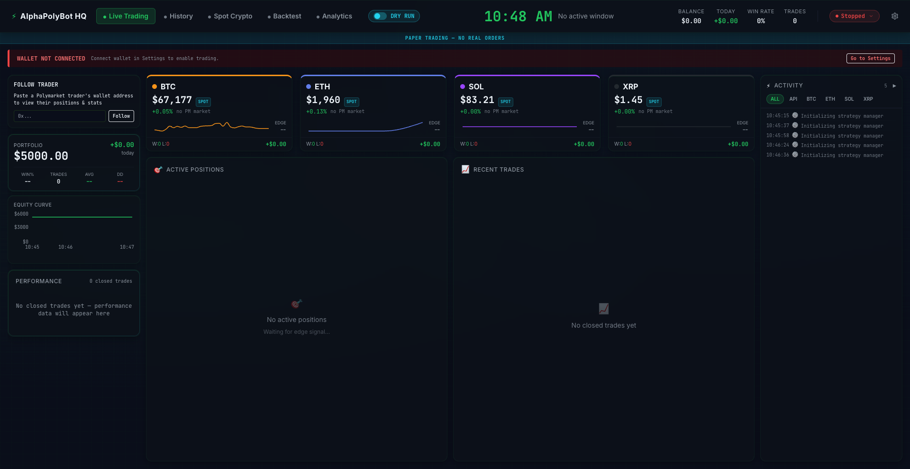
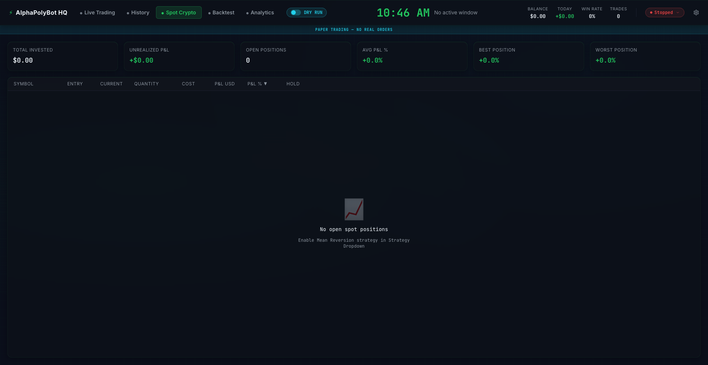
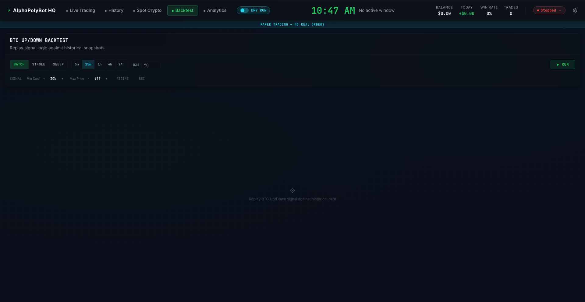
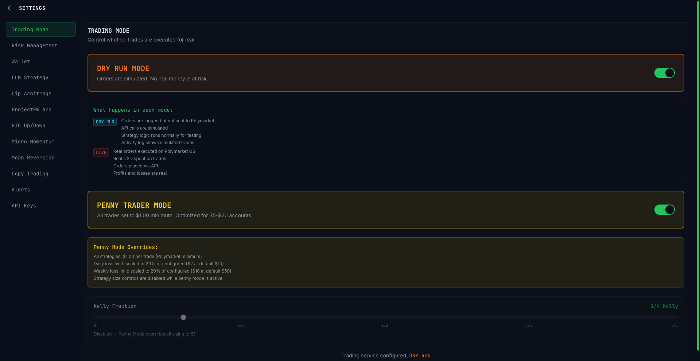

<div align="center">

# `> AlphaPolyBot_`

### Autonomous Polymarket Trading Engine

[](https://github.com/Deegan4/alphapolybot/actions)
[](https://www.typescriptlang.org/)
[](https://reactjs.org/)
[](https://vitejs.dev/)
[](#testing)
[](LICENSE)

<br/>

*A browser-based trading bot for [Polymarket US](https://polymarket.us) prediction markets running four live strategies — AI-powered LLM analysis, a 5-factor BTC Up/Down signal with dual-side maker hedging, microstructure momentum, and spot-crypto mean reversion — with the two arbitrage strategies shelved (see [migration status](#strategies)).*

<br/>

```
 ╔══════════════════════════════════════════════════════════════╗
 ║  ░▒▓ ALPHA POLY BOT ▓▒░                                    ║
 ║                                                              ║
 ║  strategies: 4 live · 2 shelved  positions: 3  P&L: +$12.47 ║
 ║  uptime: 4h 23m          risk: NOMINAL   mode: LIVE         ║
 ║                                                              ║
 ║  [LLM] scanning 847 markets...  confidence: 0.72  ████░     ║
 ║  [DIP] shelved — no exclusivity flag on PM US events        ║
 ║  [F-W] shelved — pending Polymarket US port                 ║
 ║  [BTC] 5-factor signal          score: 0.46       ████░     ║
 ║  [MIC] flow toxicity: 0.23      imbalance: +0.31  ███░░     ║
 ║  [MRV] BTC Z-score: -2.14      entry: SHORT       ████░     ║
 ║  [DSH] YES@0.52 NO@0.51        maker spread: 0.03 ███░░     ║
 ╚══════════════════════════════════════════════════════════════╝
```

<br/>



</div>

---

## Table of Contents

- [Landing Page](#landing-page)
- [Architecture](#architecture)
- [Strategies](#strategies)
- [Risk Infrastructure](#risk-infrastructure)
- [Quick Start](#quick-start)
- [Commands](#commands)
- [Testing](#testing)
- [MCP Server](#mcp-server)
- [Tech Stack](#tech-stack)
- [Project Structure](#project-structure)
- [Deployment](#deployment)
- [Disclaimer](#disclaimer)

## Screenshots

<table>
<tr>
<td width="50%">
<strong>Spot Crypto Trading</strong><br/>
Real-time BTC/ETH/SOL positions with Z-score signals
<br/><br/>

</td>
<td width="50%">
<strong>Backtest Engine</strong><br/>
Historical replay with equity curves and parameter sweeps
<br/><br/>

</td>
</tr>
<tr>
<td colspan="2">
<strong>Settings &amp; Configuration</strong><br/>
Dry run mode, penny trader, wallet management, strategy parameters
<br/><br/>

</td>
</tr>
</table>

## Landing Page

A standalone project landing page lives at [`public/landing/index.html`](public/landing/index.html) — a single self-contained file (no build step, no dependencies) that ships with the app and is served at **`/landing`** on the deployed site.

```bash
npm run dev        # then open http://localhost:4000/landing/
```

It covers the strategies, the layered architecture, the risk stack, the test suite breakdown, and quick start — with an animated Matrix rain hero, a live boot-log terminal, and a screenshot lightbox. Content stays fully visible without JavaScript, and all motion respects `prefers-reduced-motion`.

## Architecture

```
┌─────────────────────────────────────────────────────────────────┐
│                        Browser (React 18)                       │
├──────────┬──────────┬──────────┬──────────┬────────────────────┤
│ Trading  │Dashboard │ Activity │ Settings │   Notifications    │
│ Terminal │Portfolio │  + Logs  │ + Wallet │   (Toast + Audio)  │
│          │Backtest  │          │          │                    │
├──────────┴──────────┴──────────┴──────────┴────────────────────┤
│                      Zustand Stores                             │
│        settings (v32) · wallet · notifications · backtest       │
├─────────────────────────────────────────────────────────────────┤
│                     Strategy Manager                            │
│ Live: LLM · BTC Up/Down (+Dual) · Micro · Mean Rev              │
│ Shelved: Dip Arb · Frank-Wolfe Arb                              │
├─────────────────────────────────────────────────────────────────┤
│                      Trading Service                           │
│ Kelly Sizer · Gas Oracle · Order Book Depth · Trade Logger     │
│ Edge Tracker · Calibration · Rejection Tracker · Market Scanner│
├─────────────────────────────────────────────────────────────────┤
│                      Risk Manager                               │
│ Circuit Breaker · Position Lifecycle · SL/TP · Crash Recovery  │
├─────────────────────────────────────────────────────────────────┤
│ PolymarketUSClient (polymarket-us SDK: REST + Ed25519 auth)     │
│ Realtime: markets WS (prices/books) · private WS (fills)        │
│ Coinbase Client (spot crypto) · PolyBacktest (BTC history)      │
├─────────────────────────────────────────────────────────────────┤
│   Polymarket US — api.polymarket.us / gateway.polymarket.us     │
└─────────────────────────────────────────────────────────────────┘
```

## Strategies

| # | Strategy | Status | Signal Source | Edge | Frequency |
|:-:|:---------|:-------|:-------------|:-----|:----------|
| 1 | **LLM Prediction** | Live | OpenRouter multi-model analysis with Brier-score calibration tracking | AI identifies mispriced markets | Adaptive (accelerates near close) |
| 2 | **BTC Up/Down** | Live | 5-factor vol-normalized signal (momentum, velocity, time decay, value, flow) with regime detection + RSI filter | Trades crypto direction markets at resolution | Per 15-min window |
| 3 | **Dual-Side Hedge** | Live (inside BTC Up/Down) | Maker-only YES+NO orders with 70/30 directional bias, driven by BTC signal engine + DynamicFeeService EV gate | Captures spread on both sides while maintaining directional exposure | Event-driven (signal-gated) |
| 4 | **Microstructure Momentum** | Live | Bid/ask imbalance, spread volatility, trade flow toxicity via MicrostructureAnalyzer on each market's order book | Exploits informed flow signals | Continuous |
| 5 | **Mean Reversion** | Live | Z-score mean reversion on Coinbase spot crypto (BTC/ETH/SOL) via BinanceWS live feed | Fades extreme Z-score deviations | Continuous |
| 6 | **Dip Arbitrage** | Shelved | Two-leg arb below $1 | Needs outcome sets known to be complete and mutually exclusive | — |
| 7 | **Frank-Wolfe Arb** | Shelved | Bregman projection optimizer with cross-market mutex validation | Exploits ask-sum < $1.00 across outcomes | — |

**Polymarket US migration status.** The engine targets Polymarket US (slug-based REST + WebSocket via the official `polymarket-us` SDK; no wallets, no on-chain settlement). The market model was checked against the live gateway (`src/services/api/pmusWire.ts`, tested on captured fixtures):

- **Every market is one binary order book on one slug, quoted YES-side.** NO prices are derived (NO ask = 1 − YES bid). An event's markets are separate candidates (teams, price ranges, dates), each its own Yes/No market.
- **BBO and book responses are wrapped in `marketData`**, markets carry inline quotes, tick size and fee coefficient, and expose no volume or liquidity. Volume and liquidity are USD proxies from each market's BBO (shares traded and open interest).
- **Rate limit: 25 requests per second per IP**, shared by every key on that IP. On the public gateway a burst also draws a Cloudflare ban (HTTP 429, error 1015) that lasts minutes. Every SDK call goes through a shared token bucket (`requestThrottle.ts`): 8 requests per second for the gateway and 15 for the authenticated API, with a pause after a 429 that starts at 2 seconds and doubles while the ban lasts. Per-market stats lookups are budgeted and cached on top of that. A request that would wait more than 15s (gateway) or 10s (API) in the queue, as during a long ban, is dropped with `RequestDroppedError` instead of firing late on stale prices; cancels are never dropped. Balance comes from the private WebSocket's balance stream when it is live (also used for the pre-order buying-power check), with REST every 2 minutes as a safety net. Settings → API shows live request rates, 429 counts, dropped requests and any active pause per host. BTC Up/Down fetches the next window shortly before rollover (staggered per asset) instead of every asset at once after it.
- **Fees are Θ × contracts × p × (1 − p)** (Θ = 0.095 at tier 1, published per market as `feeCoefficient`): about 4.75% of the stake at 50¢. Kelly sizing and take-profit / time-exit decisions use it (`pmusFees.ts`).
- **Orders need whole contracts** unless a market's `minimumTradeQty` is below 1, so order sizes are rounded down to that step.
- **Maker-first entries (opt-in, Settings → Trading → Order Execution).** Makers pay no fee at tier 1, so buys can rest as post-only GTD orders one cent inside the spread instead of paying the taker fee. A one-sided book or a post-only rejection falls back to the normal taker order. The Settings panel shows the maker fill rate, average time to fill and the taker fees avoided (`MakerFillTracker.ts`), so you can judge whether the savings beat the missed fills, overall and per strategy. Maker-first can then be switched off for individual strategies (LLM, BTC Up/Down, Micro) while staying on for the rest. When a maker entry expires, any partial fill is tracked as a position, and the remainder is bought with a normal order if the ask is within the chase limit (default 2¢) of the maker price. In the last 5 minutes of a market window the limit widens linearly to 2.5× (capped at 5¢); after the window closes there is no chase, and maker-first is skipped entirely when a resting order would outlive the window.
- **Crypto Up/Down events** use slugs like `btc-updown-15m-2026-11-08-0130z` and publish the window and price to beat in `assetPriceTerms`. There is no 9PM series.

**Dip Arbitrage is shelved.** YES + NO on one market can never cost less than $1. Buying YES across an event's markets is riskless only when they form a complete, mutually exclusive set, and the gateway does not say which events do. Live events include nested markets ("BTC hits $150k before December" and "before January"). The two-leg implementation is kept at `git show f614500:src/services/strategies/DipArbStrategy.ts`. **Frank-Wolfe Arb** is shelved for the same reason plus its international-CLOB code (`git show 9eb00b9:src/services/strategies/`). Shelved strategies keep their settings, are hidden from the dashboard toggles and refuse to start. Copy Trading mirrored public Polygon wallets, which do not exist on Polymarket US, and was removed.

## Risk Infrastructure

| Component | Function |
|:----------|:---------|
| **Circuit Breaker** | Daily loss limit ($10), hourly trade cap (20), consecutive failure halt (5) |
| **Position Lifecycle Manager** | SL/TP enforcement via real-time WebSocket, partial exits, time-based exits, IndexedDB crash recovery |
| **Kelly Criterion Sizing** | Drawdown-adjusted fractional Kelly with high-water mark tracking |
| **Gas Oracle** | Skips trades when Polygon gas exceeds 50% of expected profit |
| **Order Book Depth** | Caps order size to available liquidity |
| **Edge Tracker** | Tracks realized vs. predicted edge with exponential decay |
| **Rejection Tracker** | Monitors exchange rejection patterns for early signal degradation |

## Quick Start

```bash
# Clone and install
git clone https://github.com/Deegan4/alphapolybot.git
cd alphapolybot
npm install

# Configure
cp .env.example .env
# Edit .env: add VITE_WALLET_SEED_PHRASE and VITE_OPENROUTER_API_KEY

# Run
npm run dev        # Dev server on :4000
```

### Setup Checklist

1. Create a **dedicated trading wallet** (not your main wallet!)
2. Fund it with **USDC.e + MATIC** on Polygon
3. Get an **OpenRouter API key** from [openrouter.ai/keys](https://openrouter.ai/keys)
4. In the app: **Settings > Wallet > Approve Tokens** (3 contracts)
5. Start in **dry run mode** — verify trades in the Activity tab
6. When confident, disable dry run for live trading

> **Warning**: Use USDC**.e** (bridged), not native USDC. The exchange only sees bridged USDC.e.

## Commands

```bash
npm run dev            # Vite dev server on :4000
npm run dev:strict-csp # Dev with strict CSP (no Fast Refresh)
npm run build          # Production build (Vite 7 + esbuild)
npm test               # 562 tests (Vitest)
npm run test:watch     # Watch mode
npm run lint           # ESLint
npm run typecheck      # TypeScript (tsc --noEmit) — also runs in CI
npm run preview        # Preview production build
```

## Testing

562 tests across 30 suites (`npm test`), plus `npm run typecheck` (strict TypeScript) and `npm run lint` — all three run in CI:

| Suite | Tests | Coverage |
|:------|------:|:---------|
| MeanReversion | 53 | Z-score computation, Coinbase integration, position tracking, RiskManager gate |
| signalEngine | 51 | Stateless 5-factor signal extraction, 5m profile, volatility/RSI helpers |
| BtcUpDownStrategy | 38 | 5-factor signal, regime detection, RSI filter, PM US Up/Down slugs |
| KellySizer | 33 | Fractional Kelly, drawdown adjustment, edge cases |
| RiskManager | 32 | Circuit breaker, emergency stop, daily limits |
| FrankWolfeOptimizer | 31 | Bregman projection, convergence, fee handling |
| PositionLifecycleManager | 28 | SL/TP enforcement (YES and NO positions), partial exits, crash recovery |
| EdgeTracker | 24 | Realized vs. predicted edge, decay tracking |
| CrossMarket | 23 | Event analysis, dependency classification, mutex |
| OpenRouterService | 21 | Budget tracking, model selection, signal fusion |
| secureStorage | 19 | Encryption, key derivation, migration |
| settingsStore | 18 | Persistence, version migration, setter isolation |
| encryptedStorage | 15 | AES-GCM device key, legacy plaintext migration |
| PolyBacktestClient | 15 | API pagination, auth, data transforms |
| pmusWire | 15 | Live wire shapes: `marketData` envelope, per-market normalization, NO-side price/book views, Up/Down slugs, stats budget ranking |
| ShelvedStrategies | 13 | Dip Arb and FW Arb shells: refuse to start, preserve settings surface |
| OrderBookDepth | 3 | YES and NO depth walks on a YES-quoted book |
| requestThrottle | 13 | Token bucket pacing, separate gateway/API buckets, escalating 429 cooldown, request metrics, stale-request dropping (cancels exempt) |
| WalletLiveBalance | 3 | Pushed balance applied while connected; REST balance only as a 2-min fallback while the private feed is live |
| pmusFees | 6 | Documented taker fee Θ·C·p(1−p), round-trip fee, fee-aware Kelly |
| pmusOrders | 15 | Quantity step rounding, decimal position fields, USD balance, latency-reject detection, 100-market WS chunks, maker entry price |
| TradingService maker-first | 11 | Post-only entry inside the spread (YES and NO), taker fallback without tripping the circuit breaker, expiry follow-up (partial fill kept, remainder taken within the chase limit), opt-in |
| MakerFillTracker | 8 | Fill rate, time to fill, taker fees avoided, per-strategy split, v1 migration, persistence and reset |
| GtcOrderManager maker | 2 | Maker orders report placement, fill, expiry and cancel; fallback orders do not |
| BacktestRunner | 12 | Historical replay, P&L/Sharpe/drawdown |
| MicrostructureMomentum | 9 | Polymarket US market selection, signal slug, config |
| MCP Orders | 19 | Intent/price mapping (NO → YES-side), order params, book summary, event flattening, live wire fixtures |
| MCP PriceHistory | 9 | Interval/fidelity profiles, custom-range validation, normalization |
| MCP Tools | 12 | Kelly sizing, opportunity scoring |
| MCP Rounding | 11 | Tick-size compliance, decimal precision |

```bash
npm test    # Runs all 562 tests in ~5s
```

## MCP Server

The `mcp-server/` directory contains a standalone [Model Context Protocol](https://modelcontextprotocol.io) server that exposes Polymarket US to LLM agents (Claude Code, Claude Desktop) over stdio. It uses the official `polymarket-us` SDK — API key + Ed25519 signing, slug-based markets — with no wallet or on-chain code.

| Tool | Auth | What it does |
|:-----|:----:|:-------------|
| `get_markets` | – | Browse/search markets: one row per tradeable slug with event, outcome, best bid/ask, tick, and volume/liquidity proxies |
| `get_market_detail` | – | Order book summary for a market slug, or every market in an event |
| `get_price_history` | – | YES/NO display-price history (fixed 1H…ALL/LIVE profiles or a ≤24h custom range), summarized + down-sampled |
| `get_crypto_prices` | – | BTC/ETH/SOL/XRP spot with 24h change (Binance → CoinGecko) |
| `compute_kelly`, `score_opportunities` | – | Pure analysis helpers |
| `get_balance`, `get_positions`, `get_open_orders` | key | Account state |
| `place_order` | key | Limit orders; **dry-run by default** (local validation + exchange preview). NO prices are converted to YES-side for you |
| `cancel_order`, `cancel_all_orders`, `close_position` | key | Writes that require `confirm: true` |

```bash
cd mcp-server
npm install
npm test       # 51 tests
npm run build
npm run smoke  # live read-only checks against the gateway; add `-- --auth` for account + order preview
# credentials (optional — read-only without them), in the repo-root .env:
#   POLYMARKET_KEY_ID=...  POLYMARKET_SECRET_KEY=...
```

Register with Claude Code: `claude mcp add polymarket-us -- node /path/to/alphapolybot/mcp-server/bootstrap.js`.

Behind an HTTPS proxy, Node's `fetch` needs `NODE_USE_ENV_PROXY=1` (Node 22.21+ or 24). The smoke test never places a live order: its `place_order` check is a dry run at 1¢.

Before running the bot live, work through [docs/DRY_RUN_CHECKLIST.md](docs/DRY_RUN_CHECKLIST.md).

## Tech Stack

| Layer | Technology |
|:------|:-----------|
| **Frontend** | React 18, TypeScript 5.3, Tailwind CSS, Framer Motion |
| **Build** | Vite 7 (esbuild transform) |
| **State** | Zustand with persist middleware (v29 schema) |
| **Blockchain** | Ethers.js v6 (Polygon), Polymarket US SDK |
| **Charts** | Recharts |
| **LLM** | OpenRouter (multi-model, budget-bucketed) |
| **Storage** | IndexedDB v4 (6 object stores), Secure encrypted localStorage |
| **Real-time** | WebSocket (market + user + RTDS + BinanceWS) |
| **Crypto Prices** | Coinbase API (HMAC-SHA256), BinanceWS |
| **Testing** | Vitest + jsdom + Testing Library |
| **CI/CD** | GitHub Actions + Netlify |

## Project Structure

```
src/
├── components/
│   ├── charts/         # MatrixLineChart, AreaChart, BarChart, PieChart, Gauge, Sparkline
│   ├── dashboard/      # BacktestView, ActivePositions, PerformancePanel, StrategyDropdown,
│   │                   # SpotCryptoView, DiagnosticsBanner, AssetCards, etc.
│   ├── layout/         # AppLayout, DashboardLayout, SettingsLayout, Header, Sidebar, MatrixRain
│   └── ui/             # 18 Matrix-themed components (Button, Card, Modal, Toast, etc.)
├── hooks/              # useWallet, useBalanceHistory, useCryptoPrices, usePolymarketPrices
├── services/
│   ├── api/            # PolymarketUSClient (official SDK wrapper), pmusWire (wire shapes), CoinbaseClient,
│   │                   # PolyBacktestClient, PriceOracleService
│   ├── llm/            # OpenRouterService (multi-model, budget-bucketed)
│   ├── notifications/  # Toast + Browser + Web Audio
│   ├── realtime/       # RealtimeService, RTDSService, UserChannelService, BinanceWSService
│   ├── storage/        # IndexedDB v4 (6 object stores)
│   ├── strategies/     # 4 live + 2 shelved strategies, ShelvedStrategy base, signal engine
│   │   ├── btcupdown/  # signalEngine, BacktestRunner, HistoricalEnrichment
│   │   └── projectfw/  # FrankWolfeOptimizer, crossmarket/ (exchange-agnostic, kept for the port)
│   ├── trading/        # TradingService, RiskManager, PLM, KellySizer, GasOracle,
│   │                   # OrderBookDepth, TradeLogger, EdgeTracker, CalibrationTracker,
│   │                   # MicrostructureAnalyzer, ReadinessChecker, RejectionTracker
│   └── wallet/         # Ethers.js wrapper, approvals, balance tracking
├── stores/             # Zustand (settings v32, wallet, notifications, backtest)
├── views/              # TradingTerminal, DashboardView, PortfolioView, ActivityView, SettingsView
├── types/              # API types, wallet types
└── utils/              # secureStorage, cn (tailwind-merge)

mcp-server/             # Standalone MCP server for AI-assisted trading
```

## Deployment

Configured for Netlify with GitHub Actions CI:

```bash
# CI runs on every push/PR to main:
# 1. npm ci
# 2. npm run lint
# 3. npm run typecheck
# 4. npm test (562 tests)
# 5. npm run build
```

Netlify config in `netlify.toml` handles SPA routing and API proxy paths.

## iPhone / mobile web app

AlphaPolyBot is a progressive web app. On an iPhone:

1. Open the deployed site in **Safari** (not an in-app browser).
2. Tap **Share** → **Add to Home Screen**.
3. Launch from the home-screen icon for a fullscreen, standalone trading UI.

The dashboard stacks into a single column on small screens, tables scroll horizontally, and safe-area insets keep controls clear of the notch and home indicator. A light service worker caches the app shell only (never trading APIs).

## Disclaimer

> **This software is for educational and research purposes only.** Trading on prediction markets involves significant financial risk. The authors are not responsible for any financial losses. Always use a dedicated wallet with funds you can afford to lose. Never trade with money you cannot afford to lose.

---

<div align="center">

Built with TypeScript, React, and too much coffee.

[Report Bug](.github/ISSUE_TEMPLATE/bug_report.md) · [Request Feature](.github/ISSUE_TEMPLATE/feature_request.md)

</div>
